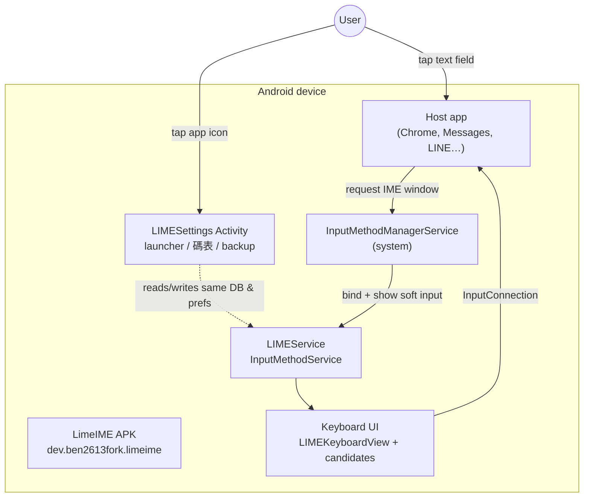
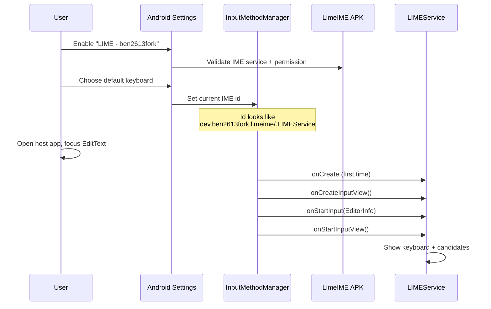
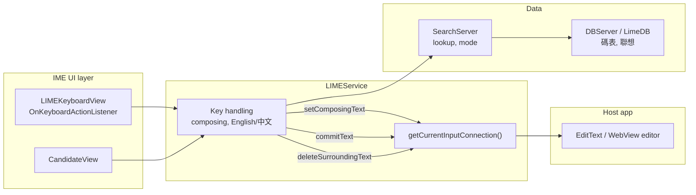
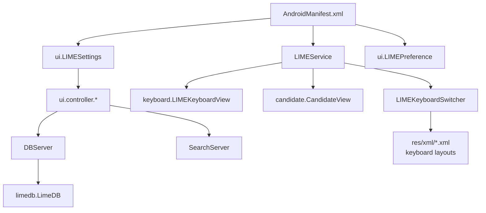
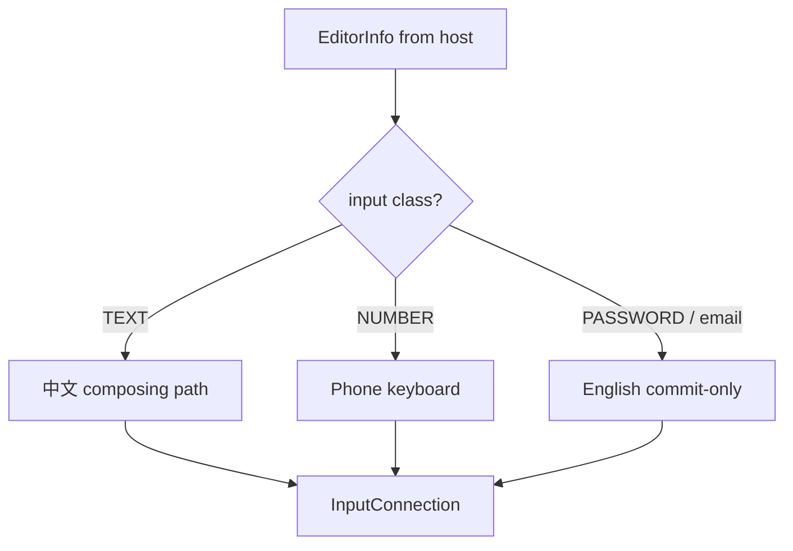
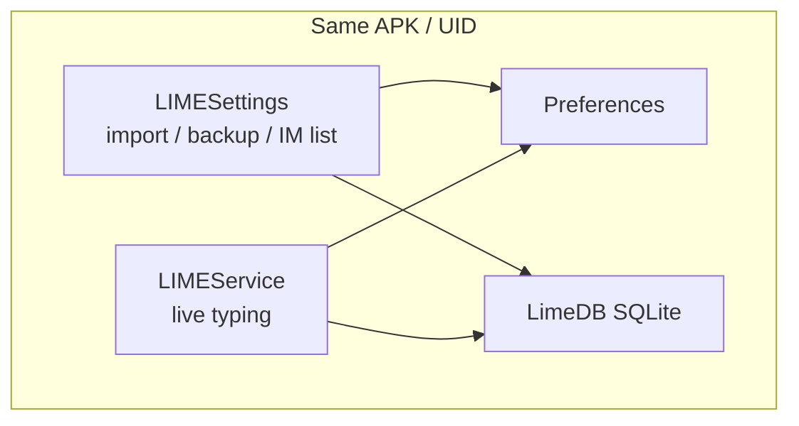

# Android input method (IME) — visual guide

A picture-first walkthrough of how Android hosts a third-party keyboard, and how **LimeIME** (`LimeStudio/`) maps onto that model. Your fork uses `applicationId` **`dev.ben2613fork.limeime`**; the mechanics below are the same.

---

## 1. One APK, two personalities

Most users think “keyboard app = one thing.” On Android it is really **two entry points** in the same package:

| Entry point | Component type | User sees it when… |
|-------------|----------------|---------------------|
| **Settings / container app** | `Activity` (`LIMESettings`) | Tapping the launcher icon |
| **Keyboard** | `Service` extending `InputMethodService` (`LIMEService`) | Focusing a text field in any app |

The system **never** launches your launcher activity to show the keyboard. It binds to the IME service when the user picks your keyboard in **Settings → System → Keyboard**.



---

## 2. How Android discovers your IME

Three manifest pieces work together (see `LimeStudio/app/src/main/AndroidManifest.xml`):

1. **`Service`** with action `android.view.InputMethod` and permission `BIND_INPUT_METHOD` (only the system can bind).
2. **Meta-data** `android.view.im` → `@xml/method` (subtype metadata, settings activity link).
3. User **enables** the IME in system settings, then **selects** it as the current keyboard.



**`res/xml/method.xml`** points `android:settingsActivity` at `org.limeime.ui.LIMESettings` so the system “open keyboard settings” shortcut can jump into your app.

---

## 3. Framework lifecycle (what `LIMEService` implements)

`InputMethodService` is the base class. LimeIME’s core hooks:

| Callback | When | LimeIME does |
|----------|------|----------------|
| `onCreateInputView()` | First keyboard paint / after config change | Builds `inputcandidate` layout, keyboard switcher, nav-bar insets (API 35+) |
| `onCreateCandidatesView()` | Optional separate candidate strip | Returns **`null`** — candidates live **inside** the input view |
| `onStartInput()` / `onStartInputView()` | User moved to a new field | Reads `EditorInfo` (password, number, URI…), resets mode, voice text handoff |
| `onFinishInput()` | Field lost focus | Reset composing state |
| `onComputeInsets()` | Layout / fullscreen | Adjust visible IME region |
| `onConfigurationChanged()` | Rotation, locale, theme | Recreate keyboard layout |

```mermaid
stateDiagram-v2
  [*] --> Idle: IME not bound
  Idle --> Bound: User focuses text field
  Bound --> InputViewReady: onCreateInputView
  InputViewReady --> Editing: onStartInputView
  Editing --> Editing: Key / candidate / voice
  Editing --> Paused: onFinishInput
  Paused --> Editing: New field (onStartInputView)
  Paused --> Idle: IME hidden / unbound
```



---

## 4. Inside LimeIME: key press → text in the host app

The host app exposes an **`InputConnection`**. Everything the keyboard “types” goes through that API — not by injecting global key events.



Typical paths:

- **Composing (中文)** — partial input in the composing region: `setComposingText(...)`, then `commitText(...)` when the user picks a candidate or commits.
- **Direct (English / password fields)** — often skip composing and `commitText` immediately (`EditorInfo` drives this in `initOnStartInput()`).

---

## 5. Code map (where to read first)



| If you want to… | Start here |
|-----------------|------------|
| Change **package / install id** | `app/build.gradle` → `applicationId` |
| Change **launcher name** | `res/values/strings.xml` → `app_name` |
| Change **IME list label** | `res/values/strings_settings.xml` → `ime_name` |
| Register IME | `AndroidManifest.xml` + `res/xml/method.xml` |
| Key behavior & committing text | `LIMEService.java` |
| Keyboard layout XML | `res/xml/`, `LIMEKeyboard.java` |
| 碼表 / SQLite | `limedb/LimeDB.java`, `DBServer.java` |
| Lookup & candidates | `SearchServer.java`, `CandidateView.java` |
| Settings UI (fragments) | `ui/LIMESettings.java`, `ui/view/*Fragment.java` |

Deeper UI patterns: [UI_ARCHITECTURE.md](UI_ARCHITECTURE.md).  
Release/signing: [APK_RELEASE_WORKFLOW.md](APK_RELEASE_WORKFLOW.md).

---

## 6. `EditorInfo`: why the same key does different things

Every field sends hints in `EditorInfo`:

- **`inputType`** — text vs number vs password, email, URI search box, etc.
- **`imeOptions`** — action key (search, done, go).

LimeIME uses these in `LIMEService` (e.g. `effectiveInputClass()`, phone keyboard mode) to force English-only on password fields, pick phone keypad for `TYPE_CLASS_NUMBER`, or avoid broken composing on mis-declared host fields.



---

## 7. Settings app vs keyboard service (data sharing)

Both run in the **same app process** when the keyboard is active (service + possibly settings activity). They share:

- **SharedPreferences** / `LIMEPreferenceManager`
- **SQLite** (`LimeDB` on device storage)
- **Downloaded 碼表** under app-private storage

So: configure in **LIMESettings**, type in **LIMEService** — one database, no cross-process IPC for normal typing.



---

## 8. Fork checklist (ben2613fork)

| Item | Your fork |
|------|-----------|
| Install identity | `dev.ben2613fork.limeime` |
| Display name | `LIME · ben2613fork` |
| Java `namespace` | Still `org.limeime` (optional to rename later) |
| Coexist with official LIME | Yes — different `applicationId` |

Build unsigned release:

```bash
cd LimeStudio
./gradlew assembleRelease
# output: app/release/LIMEHD*-v*.apk
```

Install on device: enable the IME in system settings, then select **LIME · ben2613fork** as the keyboard.

---

## 9. Mental model (one sentence)

**Android owns the window and focus; your `InputMethodService` owns the keyboard UI and talks to the focused app only through `InputConnection`.** LimeIME adds a full settings app and SQLite 碼表 stack on top of that contract.

---

## References

- [Android developers: Input method framework](https://developer.android.com/develop/ui/views/touch-and-input/creating-input-method)
- [InputMethodService API](https://developer.android.com/reference/android/inputmethodservice/InputMethodService)
- [InputConnection API](https://developer.android.com/reference/android/view/inputmethod/InputConnection)